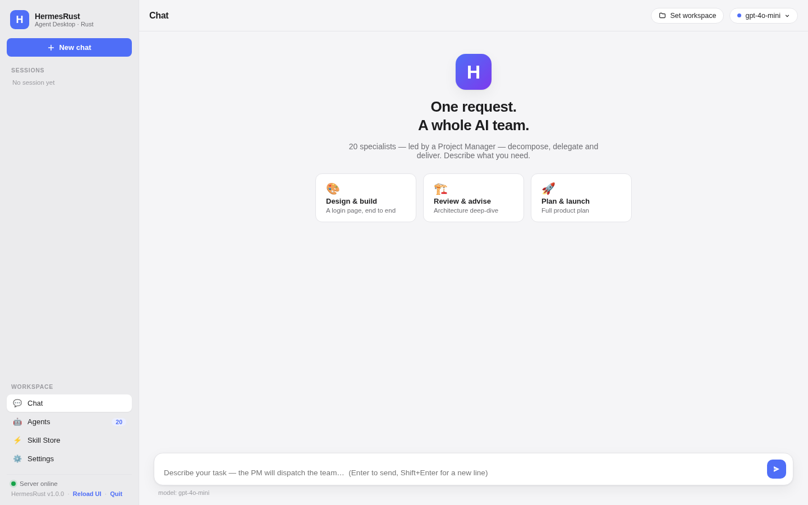
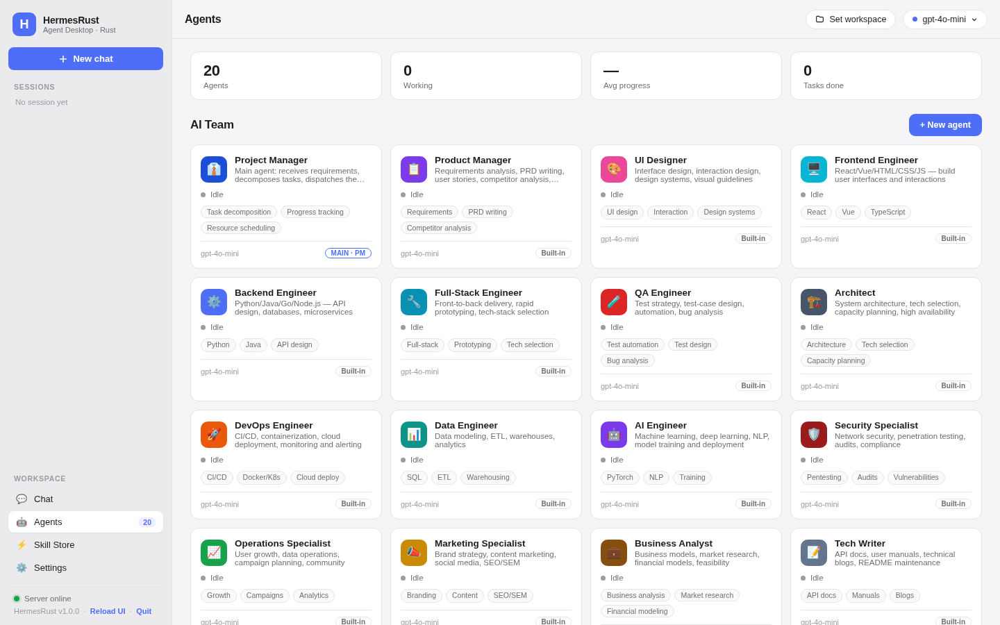
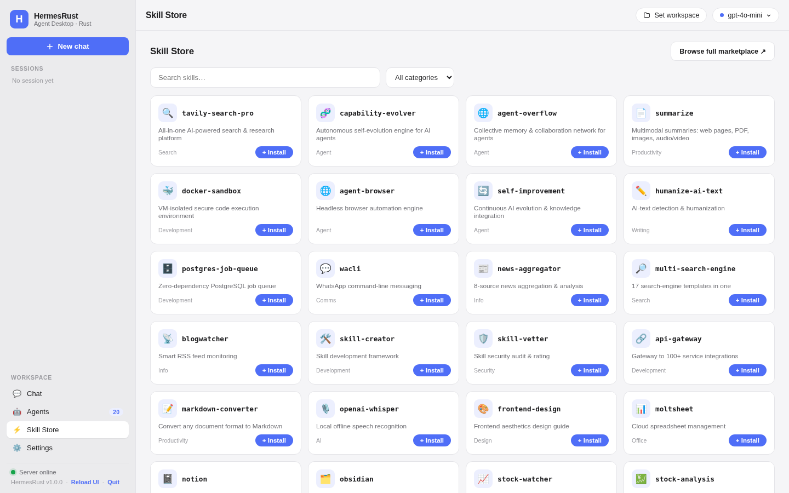
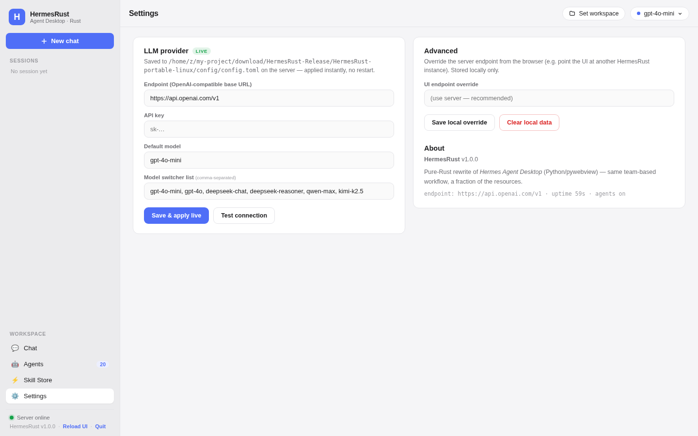

<p align="center">
  
</p>

<h1 align="center">HermesRust</h1>

<p align="center">
  <strong>Hermes Agent Desktop — rewritten in pure Rust. Same AI team, ~100× lighter, instant launch.</strong>
</p>

<p align="center">
  <a href="#features">Features</a> &bull;
  <a href="#performance">Performance</a> &bull;
  <a href="#quick-start">Quick Start</a> &bull;
  <a href="#live-editing">Live Editing</a> &bull;
  <a href="#configuration">Configuration</a> &bull;
  <a href="#architecture">Architecture</a> &bull;
  <a href="#license">License</a>
</p>

<p align="center">
  
  
  
  
  
</p>

---

> **HermesRust** is a from-scratch Rust rewrite of [hermes-agent-desktop](https://github.com/Felix-Forever/hermes-agent-desktop) (Python / pywebview / aiohttp). Every feature of the original is preserved — the 20-agent AI team, the PM orchestrator, streaming chat, the Skill Store, workspace management — with **no Python, no Node, no runtime**. One tiny binary, served UI, and everything is editable live.

Works with any OpenAI-compatible LLM provider: DashScope, OpenAI, OpenRouter, DeepSeek, Moonshot/Kimi, Ollama, LM Studio, vLLM…

---

## Why Rust

The original desktop client takes 5–10 seconds to launch and pulls in a Python interpreter, a virtual environment and the full Hermes core. HermesRust replaces all of it with a single ~3 MB static binary that starts before you can switch windows — and the whole front-end is plain HTML/CSS/JS files you can edit **while the app is running**.

### Performance comparison

| Metric | Hermes Agent Desktop (Python) | **HermesRust (Rust)** | Improvement |
|---|---|---|---|
| **Cold launch** | 5,000–10,000 ms | **~30 ms** | ~200–300× |
| **Binary / install size** | ~1–2 GB (Python + venv + deps) | **~3 MB binary** + 0.2 MB UI/config | ~1000× |
| **Idle RAM** | ~150–400 MB (interpreter + aiohttp + agent) | **~4 MB** | ~50–100× |
| **RAM while streaming** | ~200–500 MB | **~4.5 MB** | ~50–100× |
| **Dependencies to install** | Python 3.11+, pip, venv, hermes-core, pywebview | **None** | — |
| **UI hot-reload** | Restart required (single file baked in folder — same, but Python restart is slow) | **Refresh only (F5)** | instant |
| **Config changes** | Restart / re-import | **Live (≤ 0.5 s)** | instant |

> Measured on Linux x86_64 (release build, `opt-level="z"`, LTO): binary 2.66 MB, RSS 4.0 MB idle / 4.5 MB streaming, cold start 29–31 ms (spawn → HTTP ready). Replace the Python column with your own measurements — the row labels match how you'd benchmark both apps.

---

## What's New vs the Python version

| | hermes-agent-desktop (Python) | HermesRust |
|---|---|---|
| **Backend** | Python 3.11 + aiohttp + hermes-core install | 100% Rust (axum + tokio + reqwest) |
| **Orchestrator** | Built client-side in JS on every send | Built **in Rust** from the live agent registry (`config/agents.json`) |
| **Agent registry** | Baked into `index.html`, seeded once | `config/agents.json` — **hot-reloaded**, shared, AI-editable |
| **Skill catalog** | Hard-coded in the HTML | `config/skills.json` — **hot-reloaded** |
| **Provider config** | `.env` + restart-ish flow | `config/config.toml` — **hot-reloaded ≤ 0.5 s**, editable from the Settings panel too |
| **Window** | pywebview (needs Python bindings per-OS) | Browser in **app mode** (Edge/Chrome dedicated window) — zero per-OS bindings |
| **Folder picker** | pywebview dialog | Runtime OS dialog (PowerShell / osascript / zenity) — zero compile deps |
| **Sessions** | localStorage | localStorage (same keys — upgrade-friendly) |

Everything else is a faithful port: same API surface (`/v1/chat/completions` SSE, `/v1/models`, `/api/choose-folder`, `/api/list-folder`, `/health`), same `<!-- agent:ID -->` routing tags, same Apple-inspired UI, same 20-agent team.

---

## Screenshots

### Chat
Clean, distraction-free conversation view with streaming responses and multi-agent badges.

<p align="center">
  
</p>

### Agents Dashboard
Manage 20+ AI specialists with live status, skill tags and progress.

<p align="center">
  
</p>

### Skill Store
Discover and install AI skills — the catalog is a live-editable JSON file.

<p align="center">
  
</p>

### Settings
Configure the LLM provider — saved to `config/config.toml`, applied live.

<p align="center">
  
</p>

---

## Features

### Multi-Agent Collaboration System
- **20 built-in AI agents** — Project Manager, Product Manager, UI Designer, Frontend/Backend/Full-Stack Engineers, QA, Architect, DevOps, Data/AI Engineer, Security, Operations, Marketing, Business Analyst, Tech Writer, Translator, Legal Counsel, DBA, Creative Director
- **PM as orchestrator** — requirements are decomposed, delegated to specialists, and synthesized into a deliverable. The orchestration prompt is assembled by the Rust backend from the live team registry
- **Real-time agent status** — cards light up while an agent is working, with progress
- **Full agent CRUD** — create/edit/delete agents in the UI (persisted locally) or directly in `config/agents.json` (hot-reloaded, works even with multiple instances)

### Chat Interface
- **Streaming SSE responses** — token-by-token with typing cursor, backed by a Rust proxy that re-frames upstream SSE on event boundaries (a split frame can never break the stream)
- **Agent badges** — `<!-- agent:ID -->` markers become colored team badges in the conversation
- **Rich markdown** — headings, tables, lists, blockquotes, code blocks with copy button, links
- **Multiple sessions** — history auto-saved to localStorage, unsent-safe

### Skill Store
- **50+ curated skills** — searchable, category-filtered, one-click install
- **Catalog is a file** — `config/skills.json`, hot-reloaded

### Desktop Experience
- **Native-feeling window** — Edge/Chrome app mode: dedicated window, own taskbar icon, no browser chrome, no Electron, no pywebview
- **Workspace selector** — native folder dialog + in-app folder browser + recent workspaces
- **Model switcher** — quick dropdown in the top bar, custom model IDs supported
- **Settings panel** — edits the provider endpoint/key/model **live** (writes `config/config.toml`)

---

## Quick Start

### Option A — Download (easiest)

Grab a portable bundle from the [Releases](../../releases) page, or from the **Actions** tab: click the latest *Build & Release* run and download the `HermesRust-windows` artifact (Windows zip, Linux tarball, macOS zip). Extract, run `hermes-rust.exe` — the app window opens by itself.

> The zip contains everything: `hermes-rust.exe` + `ui/` + `config/`. Keep them together in the same folder.

> Building on your machine instead? See [Building](#building).

### Option B — Build from source (needs Rust)

```bash
git clone https://github.com/YOUR_USERNAME/HermesRust.git
cd HermesRust
cargo build --release
./target/release/hermes-rust          # window opens (or --no-window for server-only)
```

That's it — no Python, no npm, no virtual environments.

### Configure your provider

Edit `config/config.toml` (hot-reloaded — no restart):

```toml
endpoint = "https://dashscope.aliyuncs.com/compatible-mode/v1"
api_key  = "sk-..."
model    = "kimi-k2.5"
```

Or open the app → **Settings** → *Save & apply live*.

### Supported providers

| Provider | Base URL | Example models |
|----------|----------|----------------|
| **OpenAI** | `https://api.openai.com/v1` | `gpt-4o`, `gpt-4o-mini` |
| **Alibaba DashScope** | `https://dashscope.aliyuncs.com/compatible-mode/v1` | `kimi-k2.5`, `qwen-plus`, `qwen-max`, `deepseek-v3` |
| **DeepSeek** | `https://api.deepseek.com/v1` | `deepseek-chat`, `deepseek-reasoner` |
| **OpenRouter** | `https://openrouter.ai/api/v1` | 200+ models |
| **Moonshot/Kimi** | `https://api.moonshot.cn/v1` | `moonshot-v1-8k` |
| **Local (Ollama, LM Studio, vLLM…)** | `http://127.0.0.1:11434/v1` | any local model |

---

## Live Editing ✨

HermesRust is built to be **modified at any time, without restarting**:

| What | Where | How it applies |
|---|---|---|
| UI (layout, texts, themes, new tabs) | `ui/index.html`, `ui/app.css`, `ui/app.js` | Press **Reload UI** in the sidebar (or F5) |
| Add / edit agents | `config/agents.json` | Auto-applied **≤ 0.5 s** |
| Change provider / model / key | `config/config.toml` (or Settings panel) | Auto-applied **≤ 0.5 s** |
| Add / edit skills | `config/skills.json` | Auto-applied **≤ 0.5 s** |

> **For AI assistants:** read [`STRUCTURE.md`](STRUCTURE.md) first — it maps every file and explains exactly where to add a new tab, a new theme, a new agent, etc.

---

## Building

### Windows
```powershell
# needs Rust (rustup.rs) + Visual Studio Build Tools
.\scripts\build-windows.ps1
# → release-dist\HermesRust\hermes-rust.exe + portable zip
```

### Linux / macOS
```bash
cargo build --release
./target/release/hermes-rust
```

### Automated builds (all platforms)
A GitHub Actions workflow is included — **pushing the repo to GitHub is enough**: every push to `main` triggers a build for Windows, Linux and macOS, and the ready-to-run bundles appear as downloadable **Artifacts** on the Actions run page (`.github/workflows/release.yml`).

To additionally publish them as a GitHub Release:

```bash
git tag v1.0.0
git push origin v1.0.0
```

---

## Configuration

All configuration lives next to the binary in `config/`. Environment-variable fallbacks (`HERMES_API_KEY` / `DASHSCOPE_API_KEY` / `OPENAI_API_KEY`, `BASE_URL`, `MODEL`) mirror the original app.

<details>
<summary><b>config/config.toml — full reference</b></summary>

```toml
host = "127.0.0.1"        # bind address
port = 8642               # UI + API port (same as the original app)
endpoint = "..."          # OpenAI-compatible base URL
api_key = ""              # provider key (empty = env fallback)
model = "gpt-4o-mini"     # default model
models = [...]            # model-switcher list
orchestrator = true       # false = raw single-agent chat
open_window = true        # auto-open the app window on start
window_width = 1280
window_height = 860
ui_dir = "ui"             # where the UI is served from
```

</details>

### CLI

```
hermes-rust [--port 8642] [--host 127.0.0.1] [--no-window] [--dir PATH]
```

---

## Architecture

```
HermesRust/
├── src/                    Rust backend (100% of the logic)
│   ├── main.rs             entry point, CLI, startup banner
│   ├── config.rs           config.toml model + load/save + hot paths
│   ├── state.rs            shared state + 500 ms hot-reload watcher
│   ├── server.rs           axum router, static UI serving, CORS, /api/*
│   ├── proxy.rs            /v1/chat/completions: SSE proxy + re-framing
│   ├── orchestrator.rs     agent team + PM system-prompt builder
│   ├── folders.rs          workspace listing + native folder picker
│   └── window.rs           Edge/Chrome app-mode launcher + fallbacks
├── ui/                     front-end — plain files, served live from disk
│   ├── index.html          layout & views
│   ├── app.css             Apple-inspired design system
│   └── app.js              chat, streaming, agents CRUD, skills, settings
├── config/                 hot-reloaded configuration
│   ├── config.toml         provider, model, port…
│   ├── agents.json         the 20-agent team
│   └── skills.json         Skill Store catalog
├── tests/                  functional test suite + mock LLM upstream
├── scripts/                dev helpers + Windows build script
└── .github/workflows/      multi-platform release pipeline
```

### How it works

```
┌────────────────────────────────────┐
│  App window (Edge/Chrome app mode) │
│  ┌──────────────────────────────┐  │
│  │  ui/* — plain HTML/CSS/JS    │  │
│  │  edit anytime → F5 to apply  │  │
│  └──────────────┬───────────────┘  │
└─────────────────┼──────────────────┘
                  │ HTTP / SSE  (127.0.0.1:8642)
                  ▼
┌────────────────────────────────────┐
│        Rust backend (axum)         │
│  • /v1/chat/completions (SSE)      │  ← injects PM orchestrator prompt
│  • /v1/models · /health            │     built from config/agents.json
│  • /api/agents · /api/skills       │     or the registry sent by the UI
│  • /api/config (live PATCH)        │
│  • /api/choose-folder · list-folder│
│  • serves ui/ from disk            │
│  • hot-reload watcher (500 ms)     │
└──────────────┬─────────────────────┘
               │ HTTPS (reqwest + rustls)
               ▼
   Any OpenAI-compatible provider
   (DashScope, OpenAI, DeepSeek, Ollama…)
```

### Multi-agent orchestration flow

```
User request
     │
     ▼
Rust backend injects the PM system prompt
(team roster built from agents.json / UI registry)
     │
     ▼
PM  → analyzes, decomposes, assigns       <!-- agent:agent-pm -->
     ├── UI Designer  → design spec       <!-- agent:agent-ui -->
     ├── Frontend Eng → code              <!-- agent:agent-frontend -->
     ├── Backend Eng  → API + data        <!-- agent:agent-backend -->
     └── QA           → test plan         <!-- agent:agent-qa -->
     │
     ▼
PM  → synthesizes the final deliverable   <!-- agent:agent-pm -->
     │
     ▼
Rust proxy streams everything back, token by token;
the UI renders badges, live statuses and progress.
```

---

## Development

```bash
cargo run -- --no-window          # server only (UI at http://127.0.0.1:8642)
./scripts/dev.sh --test           # full functional test suite vs mock LLM
node --check ui/app.js            # quick JS syntax check
```

The backend compiles in ~60 s (release, cold) and the binary needs **no runtime files other than `ui/` and `config/`**.

---

## Roadmap

- [x] Rust rewrite of the full desktop client
- [x] Server-side orchestrator with live agent registry
- [x] Hot-reloadable config / agents / skills
- [x] Multi-platform CI releases (Windows / Linux / macOS)
- [ ] Server-side session persistence (SQLite) behind `X-Hermes-Session-Id`
- [ ] Real skill installation via provider tool-calls
- [ ] Tool execution sandbox (workspace-scoped file ops & shell)
- [ ] Tray icon + single-instance lock
- [ ] Themes (drop a CSS file in `ui/themes/`)

---

## Contributing

Contributions welcome! Because the UI and configs are plain files, most changes don't even require touching Rust. Open a PR or an issue — or just edit `ui/` and `config/` live in your own build.

1. Fork the repository
2. Create your branch (`git checkout -b feature/amazing-feature`)
3. Commit (`git commit -m 'Add amazing feature'`)
4. Push (`git push origin feature/amazing-feature`)
5. Open a Pull Request

---

## License

MIT License — see [LICENSE](LICENSE). A rewrite of [hermes-agent-desktop](https://github.com/Felix-Forever/hermes-agent-desktop) (MIT), which builds on [Hermes Agent](https://github.com/NousResearch/hermes-agent) by [Nous Research](https://nousresearch.com).

---

<p align="center">
  <sub>One binary. Four megabytes. A whole AI team.</sub>
</p>
